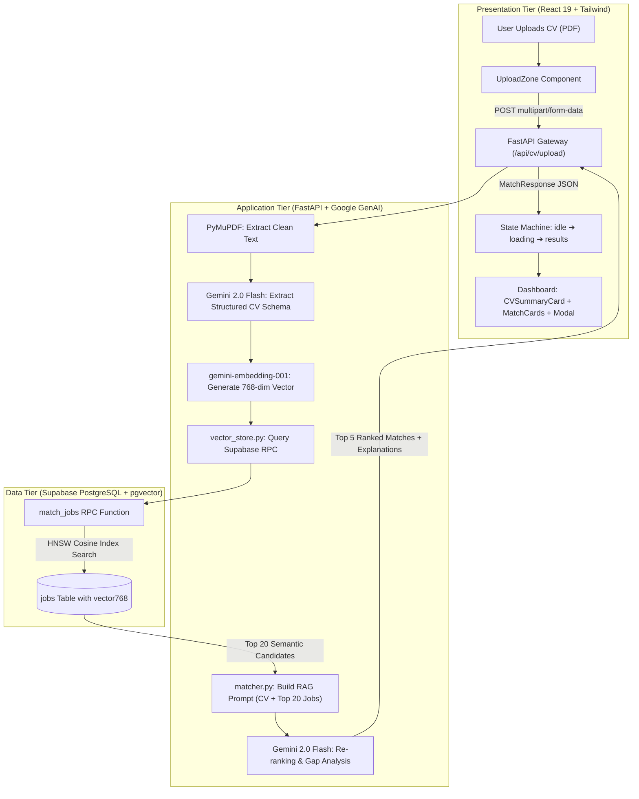

# Matchi (CV–Job Matcher)

> **Next-Generation AI-Powered Talent Discovery & Career Guidance Platform**  
> Built with Semantic Search, Vector Embeddings, and Retrieval-Augmented Generation (RAG).

[](https://matchicv.netlify.app)
[](https://github.com/AMMMMMMAR/cv-job-matcher/tree/frontend)
[](https://github.com/AMMMMMMAR/cv-job-matcher/tree/backend)
[](https://ai.google.dev/)
[](https://supabase.com/)

---

## 🌐 Live Application & Demos

- **Web Application (Netlify):** [https://matchicv.netlify.app](https://matchicv.netlify.app)
- **Interactive Workspace:** Upload any PDF resume and receive ranked job recommendations with skill-gap feedback in seconds.

---

## 🗂️ Repository Architecture & Branch Guide

To ensure high reliability and zero downtime, this project uses a **decoupled deployment architecture**. Each tier of the application is isolated in its own dedicated branch optimized for continuous integration and hosting:

| Branch | Component | Deployment Platform | Quick Links |
| :--- | :--- | :--- | :--- |
| **`main`** *(Active)* | **Repository Hub & Central Guide** | GitHub | 📖 [Overview & Architecture](#-system-architecture) |
| **`frontend`** | **Client Application** (React 19 + TypeScript + Vite + Tailwind) | [Netlify](https://matchicv.netlify.app) | 📂 [Frontend Codebase](https://github.com/AMMMMMMAR/cv-job-matcher/tree/frontend) • 📄 [Frontend Documentation](https://github.com/AMMMMMMAR/cv-job-matcher/blob/frontend/README.md) |
| **`backend`** | **Core API & RAG Engine** (FastAPI + Gemini + Supabase pgvector) | [Render](https://render.com) | 📂 [Backend Codebase](https://github.com/AMMMMMMAR/cv-job-matcher/tree/backend) • 📄 [Backend Documentation](https://github.com/AMMMMMMAR/cv-job-matcher/blob/backend/README.md) |

---

## 🎯 The Problem

Traditional Applicant Tracking Systems (ATS) and job boards rely on **rigid keyword matching**:
- **Vocabulary Mismatch:** A candidate with *"PyTorch, NLP, Transformers"* will frequently be discarded by algorithms searching for a *"Machine Learning Engineer with deep neural network expertise"*, despite having identical competencies.
- **Lack of Context:** Keyword counters fail to understand semantic depth, seniorities, or transferable cross-disciplinary skills.
- **Zero Career Guidance:** Rejected applicants receive generic rejection emails without knowing what skills they lacked or how to bridge the gap.

---

## 💡 The Matchi Solution

**Matchi** reimagines job discovery as an intelligent, two-way career advisory system using **Retrieval-Augmented Generation (RAG)**:

1. **Semantic Extraction:** Transforms messy PDF resumes into clean, validated JSON schemas with canonicalized skill tokens.
2. **Dense Vector Retrieval:** Embeds candidate experience into a shared 768-dimensional vector space, matching against thousands of live jobs in milliseconds via Supabase `pgvector` and HNSW indexing.
3. **Generative Career Reasoning:** Google Gemini re-ranks the top matches, delivers an overall compatibility score (0–100), highlights the candidate's verified strengths, identifies specific skill gaps, and outlines a personalized learning roadmap.

---

## 🏗️ System Architecture



---

## 🛠️ Complete Tech Stack

| Domain | Technology | Purpose |
| :--- | :--- | :--- |
| **Frontend Framework** | **React 19 + TypeScript** | Type-safe, component-driven user interface |
| **Build & Tooling** | **Vite 6** | Instant HMR and optimized production bundling |
| **Styling** | **Tailwind CSS** | Responsive styling with Material Symbols icons |
| **Backend Framework** | **FastAPI (Python 3.11+)** | High-throughput asynchronous REST API |
| **LLM & Reasoning** | **Google Gemini 2.0 Flash** | CV parsing, comparative ranking, and gap analysis |
| **Embeddings** | **`gemini-embedding-001`** | 768-dimensional dense vector embeddings |
| **Vector Database** | **Supabase (PostgreSQL + pgvector)** | Real-time vector search using HNSW indexing |
| **PDF Extraction** | **PyMuPDF (`fitz`)** | Robust binary PDF text extraction |
| **Job Sourcing** | **JSearch API (RapidAPI)** | Aggregating live vacancy data across global markets |
| **Hosting & CI/CD** | **Netlify (Front) & Render (Back)** | Independent, automated deployment pipelines |

---

## ⚡ Quick Start: Fullstack Local Setup

To run the complete platform locally on your machine:

### 1. Start the Backend API
```bash
# Clone the backend branch
git clone -b backend https://github.com/AMMMMMMAR/cv-job-matcher.git cv-backend
cd cv-backend

# Setup Python environment
python -m venv venv
# Windows: .\venv\Scripts\activate | Unix: source venv/bin/activate
pip install -r requirements.txt

# Configure environment
cp .env.example .env
# Set GEMINI_API_KEY, SUPABASE_URL, and SUPABASE_SERVICE_KEY in .env

# Run server
uvicorn app.main:app --host 0.0.0.0 --port 8000 --reload
```
*API docs available at: `http://localhost:8000/docs`*

### 2. Start the Frontend Application
```bash
# Open a new terminal and clone the frontend branch
git clone -b frontend https://github.com/AMMMMMMAR/cv-job-matcher.git cv-frontend
cd cv-frontend

# Install dependencies
npm install

# Configure environment
echo "VITE_API_BASE_URL=http://localhost:8000" > .env

# Run development server
npm run dev
```
*Web app available at: `http://localhost:5173`*

---

## 📊 System Modules & Capabilities

- 📄 **Smart CV Parser:** Standardizes freeform resumes into canonical skills, chronological employment histories, and educational backgrounds.
- 🌐 **Job Aggregation & Ingestion:** Pulls active roles from the JSearch API and normalizes them into structured requirements.
- 🔍 **Cosine Similarity Search:** Leverages PostgreSQL's HNSW vector indexing to calculate $1 - (\text{embedding}_1 \Leftrightarrow \text{embedding}_2)$ in milliseconds.
- 💡 **AI Career Advisory:** Generates constructive feedback for every match:
  - **Matching Strengths:** Direct capabilities verified on the candidate's CV.
  - **Skill Gaps:** Specific technologies or methodologies missing for the role.
  - **Learning Roadmap:** Actionable steps and certifications to bridge identified gaps.

---

## 👥 Authors & Acknowledgments

- **Ammar & Azzam** — Software Engineering Department
- Developed as a graduation thesis project at **OSTIM Technical University**, Ankara, Turkey.
