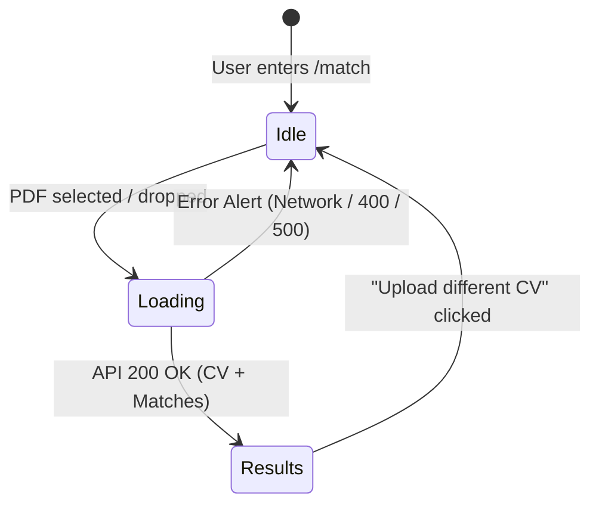

# Matchi — Frontend Web Application

> Modern, responsive React 19 web application for **Matchi**, an AI-powered CV-to-Job matching platform utilizing semantic search and Retrieval-Augmented Generation (RAG).

[](https://react.dev/)
[](https://www.typescriptlang.org/)
[](https://vitejs.dev/)
[](https://tailwindcss.com/)
[](https://matchicv.netlify.app)

---

## 📌 Repository Navigation

This repository is split into dedicated branches for streamlined hosting and decoupled CI/CD deployments:

- 🏠 **[Main Portal (Documentation & Overview)](https://github.com/AMMMMMMAR/cv-job-matcher/tree/main)** — Central project hub and full architectural guide.
- 🎨 **[Frontend Branch (React 19 + Netlify)](https://github.com/AMMMMMMAR/cv-job-matcher/tree/frontend)** *(You are here)* — Web client application and UI components.
- ⚙️ **[Backend Branch (FastAPI + Render)](https://github.com/AMMMMMMAR/cv-job-matcher/tree/backend)** — Core AI/RAG matching service.

---

## 🌐 Live Application
The web app is deployed on Netlify:
👉 **[https://matchicv.netlify.app](https://matchicv.netlify.app)**

---

## ✨ Features & User Experience

- 📄 **Drag-and-Drop Resume Upload:** Intuitive PDF upload interface with real-time validation and size formatting.
- ⏳ **Interactive Analysis State:** Dynamic visual feedback with cycling analytical status messages (*"Parsing document structure..."*, *"Extracting technical skills..."*, *"Scanning 1,200+ active roles..."*, *"Running semantic matches..."*).
- 👤 **Structured Candidate Profile:** Extracted candidate metadata displayed in an organized sidebar (`CVSummaryCard`), including title, contact information, years of experience, and canonical skill tags.
- 🎯 **AI Match Scoring:** Every recommended job features a composite AI fit score (0–100) and mathematical cosine similarity.
- 📊 **Skill-Gap Analysis Modal:** Clear breakdown of candidate matching strengths, missing requirements, and a personalized learning roadmap.
- 🔗 **Direct Application:** One-click links leading directly to original job postings.
- 🛡️ **Graceful Error Handling:** Dismissible alert banners for network failures, timeouts, and unsupported file formats.

---

## 🏗️ State Machine Architecture (`MatchiContext.tsx`)

The UI relies on a strict three-state model that governs the workspace view:



- **`idle`**: Prompts the user with `UploadZone` to drag-and-drop or browse their CV PDF.
- **`loading`**: Replaces the upload zone with an animated pulsing ring and dynamic status text cycling every 550ms.
- **`results`**: Displays the two-column dashboard with candidate summary on the left and ranked job match cards on the right.

---

## 📂 Component Directory Breakdown

```text
src/
├── api/
│   └── client.ts             # Axios HTTP client (90s timeout, error mappings)
├── assets/                   # SVG and image assets
├── components/
│   ├── CVSummaryCard.tsx     # Candidate profile sidebar (skills, experience, contact)
│   ├── FeatureCards.tsx      # Landing page feature showcase
│   ├── FlowDiagram.tsx       # Interactive RAG lifecycle diagram
│   ├── Footer.tsx            # Global application footer
│   ├── Header.tsx            # Navigation header with workspace links
│   ├── JobRequirements.tsx  # Skill badge renderer (required vs nice-to-have)
│   ├── MatchAnalysisModal.tsx# Deep-dive modal with skill gaps and learning advice
│   ├── MatchCard.tsx         # Job card with fit score, company info, and badges
│   ├── ScoreBadge.tsx        # High/Medium/Low visual compatibility badge
│   └── UploadZone.tsx        # Drag-and-drop PDF dropzone
├── context/
│   └── MatchiContext.tsx     # Global React Context & state machine provider
├── data/
│   └── mockData.ts           # Development mock payloads
├── pages/
│   ├── LandingPage.tsx       # Public homepage and platform introduction
│   └── WorkspacePage.tsx     # Core interactive matching workspace (/match)
├── types/
│   └── index.ts              # TypeScript interfaces (CV, Job, Match, AppState)
├── App.tsx                   # Route definitions (BrowserRouter)
├── main.tsx                  # React DOM root entry point
└── index.css                 # Tailwind CSS directives & base styles
```

---

## 🚀 Local Setup & Development

### 1. Prerequisites
- **Node.js 18+** installed
- **npm** or **yarn**

### 2. Installation
```bash
# Clone the frontend branch
git clone -b frontend https://github.com/AMMMMMMAR/cv-job-matcher.git cv-frontend
cd cv-frontend

# Install dependencies
npm install
```

### 3. Environment Configuration
Create a `.env` file in the root directory:
```env
# URL of your running FastAPI backend
VITE_API_BASE_URL=http://localhost:8000
```
> In production on Netlify, `VITE_API_BASE_URL` is set to the live Render backend URL.

### 4. Run Development Server
```bash
npm run dev
```
Open your browser at `http://localhost:5173`.

### 5. Production Build
```bash
npm run build
```
Build output will be generated in the `dist/` directory ready for deployment.

---

## 🚢 Deployment (Netlify)

This branch is configured for continuous deployment on **Netlify**:
1. Connect your repository to Netlify and select the **`frontend`** branch.
2. Build command: `npm run build`
3. Publish directory: `dist`
4. Set Environment Variable:
   - `VITE_API_BASE_URL`: Live Render backend URL.
